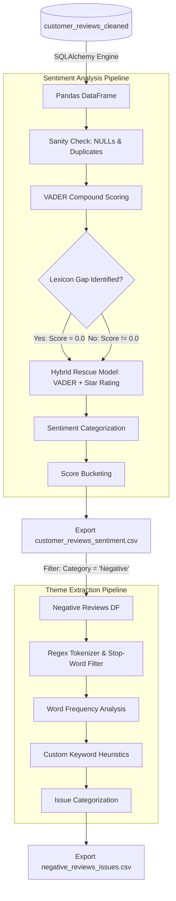

<!-- @import "[TOC]" {cmd="toc" depthFrom=1 depthTo=6 orderedList=false} -->

<!-- code_chunk_output -->

- [ShopEasy Customer Sentiment Analysis Methodology](#shopeasy-customer-sentiment-analysis-methodology)
  - [🗺️ Sentiment Analysis Pipeline Architecture](#️-sentiment-analysis-pipeline-architecture)
  - [1. Database Connection & Loading (`03_Sentiment_analysis.ipynb`)](#1-database-connection--loading-03_sentiment_analysisipynb)
    - [SQL Connection & Load](#sql-connection--load)
  - [2. Data Integrity Verification](#2-data-integrity-verification)
  - [3. VADER Sentiment Scoring](#3-vader-sentiment-scoring)
  - [4. Addressing VADER Lexicon Gaps (The Hybrid Model)](#4-addressing-vader-lexicon-gaps-the-hybrid-model)
    - [🎯 Hybrid Model Logic Mapping Table](#-hybrid-model-logic-mapping-table)
  - [5. Sentiment Bucketing](#5-sentiment-bucketing)
  - [6. Negative Review Theme Extraction](#6-negative-review-theme-extraction)
    - [A. Word Frequency Analysis](#a-word-frequency-analysis)
    - [B. Custom Keyword Heuristic Classification](#b-custom-keyword-heuristic-classification)
    - [📊 Pain Point Distribution Results](#-pain-point-distribution-results)
  - [🧠 Key NLP & Analytical Decisions](#-key-nlp--analytical-decisions)

<!-- /code_chunk_output -->

# ShopEasy Customer Sentiment Analysis Methodology

This document outlines the Python-based natural language processing (NLP) and sentiment categorization pipeline used to analyze customer reviews in the **ShopEasy Consumer Intelligence & Sentiment Analysis** project. 

The pipeline bridges the gap between raw unstructured customer text and actionable retail insights, helping ShopEasy identify product pain points and marketing misalignments.

---

## 🗺️ Sentiment Analysis Pipeline Architecture

The flowchart below displays how cleaned review data is loaded, scored via VADER, corrected using rating signals, and bucketed before undergoing theme extraction.



---

## 1. Database Connection & Loading (`03_Sentiment_analysis.ipynb`)

### SQL Connection & Load
```python
import pandas as pd
from vaderSentiment.vaderSentiment import SentimentIntensityAnalyzer
from sqlalchemy import create_engine

# Initialize SQLAlchemy engine
engine = create_engine(
    "mssql+pyodbc://localhost\\SQLEXPRESS/shopeasy?driver=ODBC+Driver+17+for+SQL+Server&trusted_connection=yes"
)

# Load database cleaned reviews
query = "SELECT * FROM dbo.customer_reviews_cleaned"
df_reviews = pd.read_sql(query, engine)
```
- **How it works**: Connects to the local MSSQL instance using the SQL Server ODBC driver and reads the pre-cleaned data validation table.

---

## 2. Data Integrity Verification

Before performing NLP, a final sanity check is run in Pandas to verify that the SQL cleaning script successfully executed and did not leave anomalies:
```python
print("NULL counts:\n", df_reviews.isna().sum())
print("Duplicate rows:", df_reviews.duplicated().sum())
print("Zero ratings:", (df_reviews['Rating'] == 0).sum())
```
- **Finding**: NULL count = 0, duplicates = 0, zero ratings = 0. The dataset is fully validated and ready for NLP modeling.

---

## 3. VADER Sentiment Scoring

```python
analyzer = SentimentIntensityAnalyzer()
df_reviews['SentimentScore'] = df_reviews['ReviewText'].apply(
    lambda x: analyzer.polarity_scores(x)['compound']
)
```
- **Why VADER?**
  **VADER** (Valence Aware Dictionary and sEntiment Reasoner) is a lexicon and rule-based sentiment analysis tool. It is specifically tuned to social media micro-texts and product reviews because it evaluates capitalization emphasis, punctuation (exclamation points), and emojis.
- **Metric**: The `compound` score is a normalized metric ranging from **-1.0 (extremely negative)** to **+1.0 (extremely positive)**.

---

## 4. Addressing VADER Lexicon Gaps (The Hybrid Model)

During analysis, a severe VADER limitation was identified. Highly positive expressions common in e-commerce, such as **"The quality is top-notch"** or **"Five stars for the quick delivery"**, returned a compound score of **`0.0000` (Neutral)**. VADER's pre-built lexicon lacks context-specific retail terminology.

To resolve this, we implemented a **Hybrid Sentiment Model** combining VADER compound scores and customer star ratings:

```python
def categorize_sentiment(score, rating):
    if score > 0.05: 
        if rating >= 4:
            return 'Positive'  
        elif rating == 3:
            return 'Mixed Positive'  
        else:
            return 'Mixed Negative'  
    elif score < -0.05: 
        if rating <= 2:
            return 'Negative'  
        elif rating == 3:
            return 'Mixed Negative' 
        else:
            return 'Mixed Positive'  
    else:  # Neutral VADER Score (0.0)
        if rating >= 4:
            return 'Positive'  # Rescued Lexicon Gap
        elif rating <= 2:
            return 'Negative'  # Rescued Lexicon Gap
        else:
            return 'Neutral'

df_reviews['SentimentCategory'] = df_reviews.apply(
    lambda row: categorize_sentiment(row['SentimentScore'], row['Rating']),
    axis=1
)
```

### 🎯 Hybrid Model Logic Mapping Table

| VADER Compound Range | Rating | Output Sentiment Category | Reason / Logic |
|---|---|---|---|
| **$> 0.05$** (Positive NLP) | $\ge 4$ | **Positive** | Text and star rating both confirm high satisfaction. |
| **$> 0.05$** (Positive NLP) | $= 3$ | **Mixed Positive** | Text expresses positivity, but rating indicates average experience. |
| **$> 0.05$** (Positive NLP) | $\le 2$ | **Mixed Negative** | Text contains positive words but rating is low (potential sarcasm/negation). |
| **$< -0.05$** (Negative NLP) | $\le 2$ | **Negative** | Text and rating both confirm high dissatisfaction. |
| **$< -0.05$** (Negative NLP) | $= 3$ | **Mixed Negative** | Neutral rating with negative text highlights hidden frustration. |
| **$< -0.05$** (Negative NLP) | $\ge 4$ | **Mixed Positive** | High star rating despite negative text words (possible mixed feedback). |
| **$-0.05 \le \text{Score} \le 0.05$** | $\ge 4$ | **Positive** | **Rescued Gaps:** VADER was neutral, but high rating confirms positive intent. |
| **$-0.05 \le \text{Score} \le 0.05$** | $\le 2$ | **Negative** | **Rescued Gaps:** VADER was neutral, but low rating confirms negative intent. |
| **$-0.05 \le \text{Score} \le 0.05$** | $= 3$ | **Neutral** | Text and rating both confirm a completely average experience. |

---

## 5. Sentiment Bucketing

To create clean chart groups for Power BI, the compound scores are segmented into numeric bands:
```python
def sentiment_bucket(score):
    if score >= 0.5:
        return '0.5 to 1.0'  
    elif 0.0 <= score < 0.5:
        return '0.0 to 0.49' 
    elif -0.5 <= score < 0.0:
        return '-0.49 to 0.0'  
    else:
        return '-1.0 to -0.5' 

df_reviews['SentimentBucket'] = df_reviews['SentimentScore'].apply(sentiment_bucket)
```
- **Export**: The resulting DataFrame is saved to `customer_reviews_sentiment.csv`.

---

## 6. Negative Review Theme Extraction

To understand *why* customers were unhappy, a granular theme extraction script isolates and analyzes reviews categorized as **Negative** ($233$ rows).

### A. Word Frequency Analysis
```python
from collections import Counter
import re

# Filter negative reviews
df_negative = df_reviews[df_reviews['SentimentCategory'] == 'Negative']

# Tokenize and normalize review text
negative_text = ' '.join(df_negative['ReviewText'].str.lower())
words = re.findall(r'\b\w+\b', negative_text)
word_counts = Counter(words)

# Define and remove generic stop-words
stop_words = ['the', 'a', 'is', 'it', 'was', 'and', 'for', 'to', 'of', 'my', 'i', 'not', 'be', 'very', 'this', 'that', 'with', 'on', 'are', 'but']
filtered = {w: c for w, c in word_counts.items() if w not in stop_words}
print(Counter(filtered).most_common(30))
```
- **Findings**: The most frequent terms in negative reviews include:
  - `product` (112x)
  - `worth` (47x), `money` (47x)
  - `expectations` (38x), `meet` (38x)
  - `arrived` (38x), `late` (38x)
  - `average` (32x), `nothing` (32x), `special` (32x)

### B. Custom Keyword Heuristic Classification
Based on the word frequency counts, a classification parser groups complaints into business departments:

```python
def categorize_issue(text):
    text = text.lower()
    if any(word in text for word in ["worth", "money", "expensive", "price", "costly"]):
        return "Product Cost"
    elif any(word in text for word in ["arrived", "late", "delivery", "shipping"]):
        return "Delivery"
    elif any(word in text for word in ["meet", "expectations", "average", "nothing", "special"]):
        return "Unmet Expectations"
    elif any(word in text for word in ["stopped", "working", "broke", "month"]):
        return "Durability"
    elif any(word in text for word in ["performance", "disappointed", "bad", "terrible"]):
        return "Product Performance"
    elif any(word in text for word in ["instructions", "unclear", "confusing"]):
        return "Usability"
    elif any(word in text for word in ["customer", "service", "support"]):
        return "Customer Service"
    else:
        return "General Dissatisfaction"

df_negative['IssueCategory'] = df_negative['ReviewText'].apply(categorize_issue)
```

### 📊 Pain Point Distribution Results

Executing the heuristic categorizer on the 233 negative reviews yields the following breakdown:

| Issue Category | Review Count | Trigger Words | Business Impact |
|---|---|---|---|
| **Unmet Expectations** | 70 | *meet, expectations, average, nothing, special* | Indicates product page text/image misalignments. |
| **Product Cost** | 47 | *worth, money, expensive, price, costly* | Price sensitivity or lack of perceived value. |
| **Product Performance** | 40 | *performance, disappointed, bad, terrible* | Quality control issues or poor product utility. |
| **Delivery** | 38 | *arrived, late, delivery, shipping* | Supply chain / logistics friction. |
| **Durability** | 18 | *stopped, working, broke, month* | Material failures occurring post-purchase. |
| **Usability** | 9 | *instructions, unclear, confusing* | Out-of-box user experience gaps. |
| **General Dissatisfaction** | 4 | *unmatched cases* | Generic dissatisfaction statements. |
| **Customer Service** | 0 | *customer, service, support* | Zero complaints (highly positive operational signal). |

- **Export**: Saved to `negative_reviews_issues.csv` for dashboard mapping.

---

## 🧠 Key NLP & Analytical Decisions

> [!NOTE]
> **Rescuing Neutral Scores via Ratings**
> Standard VADER assigns a neutral score to sentences without explicit sentiment terms, creating a "false neutral" bias in e-commerce text (e.g., "Five stars for delivery"). Combining ratings and scores corrects VADER's lexicon limitations and increases overall classification accuracy.

> [!IMPORTANT]
> **Identifying "Mixed Negative" Customers**
> Customers who give an acceptable rating of 3 but leave negative review text represent a hidden churn risk. A standard analysis focused only on ratings would miss this signal. Our hybrid model flags this category to allow for targeted customer outreach.

> [!WARNING]
> **Keyword Matching Limitations**
> Heuristic keyword matching does not handle sarcasm, complex negations, or multi-topic reviews. For larger datasets, TF-IDF vectorization, Latent Dirichlet Allocation (LDA), or transformer-based models (like **BERTopic**) should replace simple keyword mapping.
