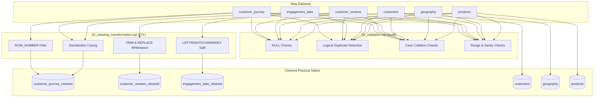

# ShopEasy SQL Data Validation & Transformation Guide

This document provides a detailed explanation of all SQL queries used to validate, clean, and transform the raw datasets in the **ShopEasy Consumer Intelligence & Sentiment Analysis** project. 

The data processing pipeline is divided into two distinct phases:
1. **Data Validation (`01.Data_Validation.sql`)**: Identifying structural issues, duplicates, anomalies, and inconsistencies without modifying any data.
2. **Data Cleaning & Transformation (`02_cleaning_transformation.sql`)**: Resolving validation issues, splitting combined fields, normalizing text casing, and materializing clean physical tables for downstream analytics in Python and Power BI.

---

## 🗺️ SQL Data Pipeline Architecture

The following diagram illustrates the workflow from raw source tables through validation checks to the finalized clean physical tables.



---

## 1. Data Validation Phase (`01.Data_Validation.sql`)

### Database Activation
```sql
use shopeasy
go
```
- **Goal**: Switches the database execution context to `shopeasy` so all subsequent operations target the correct tables.

---

### A. Customer Journey Table (`customer_journey`)

#### 1. NULL Checks
```sql
SELECT 
    COUNT(*) AS total_rows, -- 4011 rows
    SUM(CASE WHEN CustomerID IS NULL THEN 1 ELSE 0 END) AS null_customer_id,
    SUM(CASE WHEN ProductID IS NULL THEN 1 ELSE 0 END) AS null_product_id,
    SUM(CASE WHEN VisitDate IS NULL THEN 1 ELSE 0 END) AS null_visite_date,
    SUM(CASE WHEN stage IS NULL THEN 1 ELSE 0 END) AS null_stage,
    SUM(CASE WHEN action IS NULL THEN 1 ELSE 0 END) AS null_action,
    SUM(CASE WHEN Duration IS NULL THEN 1 ELSE 0 END) AS null_duration -- 613 nulls 
FROM dbo.customer_journey;
```
- **How it works**: By nesting `CASE WHEN Column IS NULL THEN 1 ELSE 0 END` within a `SUM()`, this query counts the exact number of NULL values for each column across all rows in a single pass, without filtering the row count.
- **Finding**: Identified **613 NULLs** in the `Duration` column.

#### 2. Investigating `Duration` NULLs
```sql
SELECT 
    COUNT(*) AS total_rows,
    Action, 
    Stage 
FROM customer_journey 
WHERE Duration IS NULL
GROUP BY Action, Stage;
```
- **How it works**: Groups all rows containing NULL durations by their `Action` and `Stage` to identify patterns.
- **Finding**: All 613 NULLs occurred during the `Click` action at the `Checkout` or `ProductPage` stages (representing drop-off events). This proved that the NULLs were intentional and logical, as no duration exists for a page drop-off. 

#### 3. Logical Duplicate Check
```sql
WITH duplicates AS (
    SELECT 
        JourneyID, CustomerID, ProductID, VisitDate, Stage, Action, Duration,
        ROW_NUMBER() OVER (
            PARTITION BY CustomerID, ProductID, VisitDate, Stage, Action 
            ORDER BY JourneyID 
        ) AS rnk 
    FROM customer_journey
)
SELECT * FROM duplicates 
WHERE rnk > 1;
```
- **How it works**: Employs a Common Table Expression (CTE) combined with `ROW_NUMBER()`. It partitions (groups) the rows by the business logic keys (`CustomerID`, `ProductID`, `VisitDate`, `Stage`, `Action`) and ranks them based on `JourneyID`. Any record with `rnk > 1` represents a redundant logical interaction occurring at the same time.
- **Finding**: Found **79 logical duplicates**.

#### 4. Case-Sensitive Collation Checks
```sql
SELECT DISTINCT Stage COLLATE Latin1_General_CS_AS FROM dbo.customer_journey;
SELECT DISTINCT Action COLLATE Latin1_General_CS_AS FROM dbo.customer_journey;
```
- **How it works**: SQL Server is typically configured as Case-Insensitive (`CI`). A normal `SELECT DISTINCT` would group `checkout` and `Checkout` together. Appending `COLLATE Latin1_General_CS_AS` (Case-Sensitive, Accent-Sensitive) forces SQL Server to treat lowercase and uppercase strings as distinct, revealing hidden casing discrepancies.
- **Finding**: Identified casing discrepancies across `Stage` and `Action` values (e.g., `checkout`, `Checkout`, `CHECKOUT`).

---

### B. Customer Reviews Table (`customer_reviews`)

#### 1. Range Validation (Star Ratings)
```sql
SELECT COUNT(*) AS invalid_ratings
FROM dbo.customer_reviews
WHERE Rating < 1 OR Rating > 5;
```
- **Goal**: Verifies that all ratings fall within the standard 1–5 range.
- **Finding**: **0 invalid ratings** found.

#### 2. Review Duplicate Check
```sql
WITH duplicates AS (
    SELECT
        ReviewID, CustomerID, ProductID, ReviewDate, Rating, ReviewText,
        ROW_NUMBER() OVER (
            PARTITION BY CustomerID, ProductID, ReviewDate
            ORDER BY ReviewID
        ) AS rnk
    FROM dbo.customer_reviews
)
SELECT * FROM duplicates WHERE rnk > 1;
```
- **Goal**: Checks if a customer reviewed the exact same product multiple times on the same date.
- **Finding**: **0 duplicate reviews** found.

---

### C. Customer Engagement Table (`engagement_data`)

#### 1. Engagement Duplicate Check
```sql
WITH duplicates AS (
    SELECT
        *,
        ROW_NUMBER() OVER (
            PARTITION BY ContentID, ProductID, EngagementDate, CampaignID, ContentType
            ORDER BY EngagementID
        ) AS rnk
    FROM dbo.engagement_data
)
SELECT * FROM duplicates WHERE rnk > 1;
```
- **Goal**: Identifies identical marketing campaign logs on the same date.
- **Finding**: **0 duplicate engagement logs** found.

#### 2. Casing Discrepancy Check
```sql
SELECT DISTINCT ContentType COLLATE Latin1_General_CS_AS
FROM [dbo].[engagement_data];
```
- **Goal**: Checks if `ContentType` contains mixed-casing issues.
- **Finding**: Discovered 3 casing variants per content type (e.g., `Blog`, `blog`, `BLOG`).

---

### D. Customer, Geography, and Product Tables (Dimensions)

#### 1. Age Range Check (`customers`)
```sql
SELECT COUNT(*) AS invalid_age
FROM dbo.customers
WHERE Age < 18 OR Age > 100;
```
- **Goal**: Checks for outlier ages.
- **Finding**: **0 invalid ages** found.

#### 2. Zero-Price Check (`products`)
```sql
SELECT COUNT(*) AS zero_price 
FROM dbo.products 
WHERE Price = 0;
```
- **Goal**: Ensures that no retail products are listed with a $0 price tag.
- **Finding**: **0 zero-price records** found.

---

## 2. Cleaning & Transformation Phase (`02_cleaning_transformation.sql`)

This phase cleanses the inconsistencies and creates dedicated physical tables (`_cleaned`) to optimize query speeds for Power BI and Python analysis.

---

### A. Deduplicating and Normalizing Customer Journey
```sql
WITH duplicates AS (
    SELECT 
        JourneyID, CustomerID, ProductID, VisitDate, Stage, Action, Duration,
        ROW_NUMBER() OVER (
            PARTITION BY CustomerID, ProductID, VisitDate, Stage, Action 
            ORDER BY JourneyID 
        ) AS rnk 
    FROM customer_journey
)
SELECT 
    JourneyID, CustomerID, ProductID, VisitDate, Stage, Action, Duration
INTO dbo.customer_journey_cleaned
FROM duplicates
WHERE rnk = 1;
```
- **How it works**: Uses the same CTE logic from the validation phase to identify duplicates, but filters for `rnk = 1` (retaining only the first instance of each logical record). The `INTO` clause creates a clean physical table `dbo.customer_journey_cleaned`.
- **Result**: **3,932 rows** inserted; **79 duplicates removed**.

---

### B. Standardizing Stage Casing (`customer_journey_cleaned`)
```sql
UPDATE [dbo].[customer_journey_cleaned]
SET Stage = CASE 
    WHEN UPPER(Stage) = 'CHECKOUT' THEN 'Checkout'
    WHEN UPPER(Stage) = 'HOMEPAGE' THEN 'Homepage'
    WHEN UPPER(Stage) = 'PRODUCTPAGE' THEN 'ProductPage'
    ELSE Stage 
END;
```
- **How it works**: Updates the table values by evaluating the uppercase equivalent (`UPPER()`) of the `Stage` strings and converting them into uniform CamelCase format (`Checkout`, `Homepage`, `ProductPage`).

---

### C. Splitting Columns and Normalizing Casing (`engagement_data_cleaned`)
```sql
SELECT 
    EngagementID,
    ContentID,
    CASE 
        WHEN UPPER(ContentType) = 'BLOG' THEN 'Blog'
        WHEN UPPER(ContentType) = 'SOCIALMEDIA' THEN 'Socialmedia'
        WHEN UPPER(ContentType) = 'VIDEO' THEN 'Video'
        WHEN UPPER(ContentType) = 'NEWSLETTER' THEN 'Newsletter'
        ELSE ContentType
    END AS ContentType,
    Likes,
    CONVERT(date, EngagementDate) AS EngagementDate,
    CampaignID,
    ProductID,
    CONVERT(int, LEFT(ViewsClicksCombined, CHARINDEX('-', ViewsClicksCombined) - 1)) AS Views,
    CONVERT(int, RIGHT(ViewsClicksCombined, LEN(ViewsClicksCombined) - CHARINDEX('-', ViewsClicksCombined))) AS Clicks
INTO dbo.engagement_data_cleaned
FROM [dbo].[engagement_data];
```

#### 🔍 String Splitting Mechanics Deep-Dive

The column `ViewsClicksCombined` stored metrics in a concatenated format (e.g., `"1200-350"`). To make these metrics usable, they were split into `Views` and `Clicks` using mathematical string position calculations:

1. **`CHARINDEX('-', ViewsClicksCombined)`**:
   Finds the position of the separator hyphen (`-`). For `"1200-350"`, the hyphen is at index `5`.
2. **Views Extraction (`LEFT` substring)**:
   - `LEFT(ViewsClicksCombined, 5 - 1)` extracts the first 4 characters (`"1200"`).
   - `CONVERT(int, ...)` cast the resulting string into an integer.
3. **Clicks Extraction (`RIGHT` substring)**:
   - `LEN(ViewsClicksCombined)` gets the total length (`8`).
   - `8 - 5 = 3`.
   - `RIGHT(ViewsClicksCombined, 3)` extracts the last 3 characters from the right (`"350"`).
   - `CONVERT(int, ...)` cast the resulting string into an integer.
4. **Standardization**:
   - `CONVERT(date, EngagementDate)` drops the timestamp, keeping only the calendar date.
   - `CASE WHEN UPPER(...)` standardizes the casing of marketing channel names.
- **Result**: **4,623 rows** parsed and inserted into `dbo.engagement_data_cleaned`.

---

### D. Cleaning Whitespace in Review Text (`customer_reviews_cleaned`)
```sql
SELECT
    ReviewID,
    CustomerID,
    ProductID,
    ReviewDate,
    Rating,
    TRIM(REPLACE(ReviewText, '  ', ' ')) AS ReviewText
INTO dbo.customer_reviews_cleaned
FROM [dbo].[customer_reviews];
```
- **How it works**:
  - `REPLACE(ReviewText, '  ', ' ')`: Replaces instances of double spaces with a single space.
  - `TRIM(...)`: Removes any leading or trailing spaces from the text.
  - `INTO`: Materializes the cleaned records into `dbo.customer_reviews_cleaned`.
- **Result**: **1,363 rows** cleaned and saved.

---

## 🧠 Key Analytical & Architectural Decisions

> [!NOTE]
> **Physical Tables over Views**
> Database views execute their internal code on every call, which creates performance overhead. Creating physical tables (`_cleaned`) provides a stable, static, and highly performant data foundation that speeds up Power BI refresh times and Python data-loading steps.

> [!IMPORTANT]
> **Case Collation (`COLLATE`)**
> Standard SQL Server settings ignore differences between capital and lowercase letters. Utilizing `COLLATE Latin1_General_CS_AS` was critical in the validation phase to identify hidden database inconsistencies that would otherwise remain masked.

> [!TIP]
> **Preserving NULL Durations**
> Since `Duration IS NULL` only occurred on checkout or product page drop-offs, replacing them with a zero (`0`) or an average would corrupt session duration metrics. Preserving the NULLs maintains data integrity for conversion funnel visualizations.
